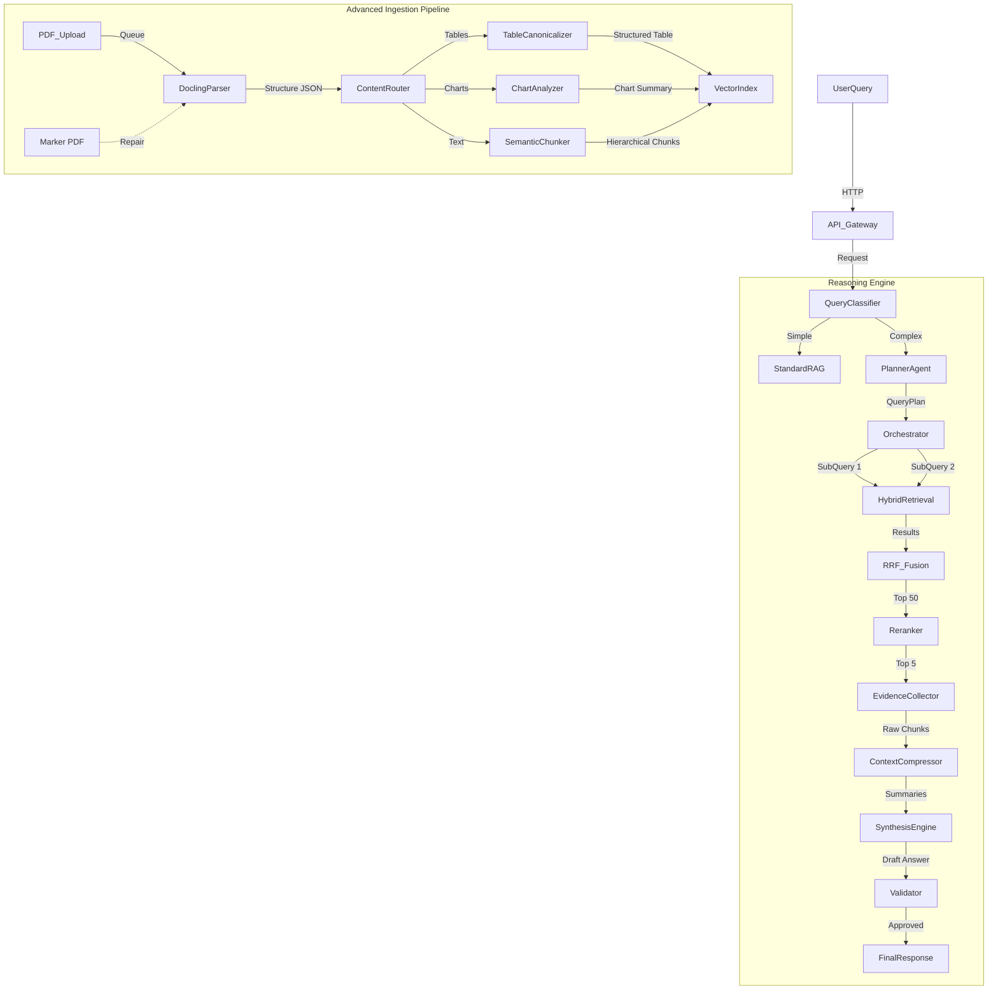

# Enterprise Retrieval Reasoning Engine (RRE) - Architecture Specification v2.0

## 1. Executive Summary
This document defines the architecture for a Production-Grade Retrieval Reasoning Engine designed to answer complex financial analytical queries from 400+ page corporate documents. It transitions from standard RAG to a **Planner-Driven Multi-Hop Retrieval** system with **Advanced Multimodal Ingestion**.

## 2. System Architecture

### 2.1 High-Level Data Flow



## 3. Advanced Ingestion Pipeline

### 3.1 Primary Parser: Docling
*   **Role**: Structural backbone. Extracts efficient JSON representation of PDF/DOCX.
*   **Outputs**:
    *   `Section Hierarchy`: Tree structure of headers/subheaders.
    *   `Tables`: HTML/Markdown representation + bounding boxes.
    *   `Images/Charts`: Extracted as assets.
    *   `Reading Order`: Preserved logical flow.

### 3.2 Fallback: Marker PDF
*   **Role**: Resilience layer.
*   **Trigger**: If Docling fails or table confidence < 0.6.
*   **Action**: Re-parse specific pages and merge results.

### 3.3 Semantic Enrichment Layers
1.  **Chart Understanding Layer**: Uses VLM (Llava/GPT-4V) to generate:
    *   `Axis Labels`, `Trends`, `Anomalies`, `Data Summary`.
2.  **Table Canonicalization**:
    *   Converts all tables to standard Markdown/HTML.
    *   Augments headers with context (e.g., "Revenue" -> "Revenue (FY24) in INR Crores").
3.  **Hierarchical Chunking**:
    *   **Level 1**: Section Summaries (Large context).
    *   **Level 2**: Paragraphs (High precision).
    *   **Level 3**: Table Rows/Summaries (Data points).

## 4. Query Reasoning Engine

### 4.1 Query Planner Agent (Llama-3.1-70B)
*   **Prompt Strategy**: "Architect" Persona.
*   **Output**: JSON `QueryPlan` with entity constraints and time ranges.
*   **Logic**:
    *   Decompose causal queries ("Why did X happen?").
    *   Separate temporal chunks ("Compare Q1 vs Q4").
    *   Assign specific `content_type` filters (Table vs Text).

### 4.2 Multi-Hop Executor
*   **Parallel Execution**: `asyncio.gather` for independent sub-queries.
*   **Hybrid Search**:
    *   Dense: `nvidia/nv-embedqa-e5-v5` (1024-dim).
    *   Sparse: BM25/Splade on specialized financial vocabulary.
*   **Fusion**: Reciprocal Rank Fusion ($k=60$).
*   **Reranking**: `nvidia/nv-rerankqa-mistral-4b-v3`.

### 4.3 Context Compression Agent
*   **Goal**: Reduce noise before Synthesis.
*   **Action**: Summarize 5 chunks -> 1 dense bulleted list per sub-query.
*   **Constraint**: Preserve all numbers, dates, and Entity Names.

### 4.4 Synthesis Engine
*   **Traceability**: Every claim must have a `[Source]` citation.
*   **Format**: Adaptive (Table for comparisons, Bullets for lists, Prose for analysis).
*   **Uncertainty**: Explicit "Data Missing" declarations.

## 5. Data & Schema Definitions

### 5.1 Hierarchical Chunk Schema
```json
{
  "id": "uuid",
  "text": "content...",
  "vector": [0.1, ...],
  "payload": {
    "source_doc": "Annual_Report_2024.pdf",
    "page": 42,
    "chunk_type": "table_summary | paragraph | chart_analysis",
    "hierarchy": {
      "h1": "Financial Performance",
      "h2": "Revenue Analysis"
    },
    "entities": ["EBITDA", "Steel"],
    "time_period": "FY24"
  }
}
```

## 6. Observability & Evaluation

### 6.1 Telemetry
*   **Langfuse/Arize**: Trace every Planner Step and Sub-Query.
*   **Metrics**:
    *   `planning_latency`: Time to generate plan.
    *   `sub_query_recall`: % of sub-queries returning >0 results.
    *   `retrieval_precision`: Reranker scores.

### 6.2 Evaluation (RAGAS)
*   **Faithfulness**: Does answer match Compressed Context?
*   **Answer Relevance**: Does answer match Original Query?
*   **Context Recall**: Is the ground truth present in Top-k?

## 7. Security Strategy
*   **RBAC**: Row-level security in Qdrant (User Group filtering).
*   **Encryption**: TLS 1.3 in transit, AES-256 for Object Storage.
*   **LLM Safety**: NeMo Guardrails for input/output sanitization.
