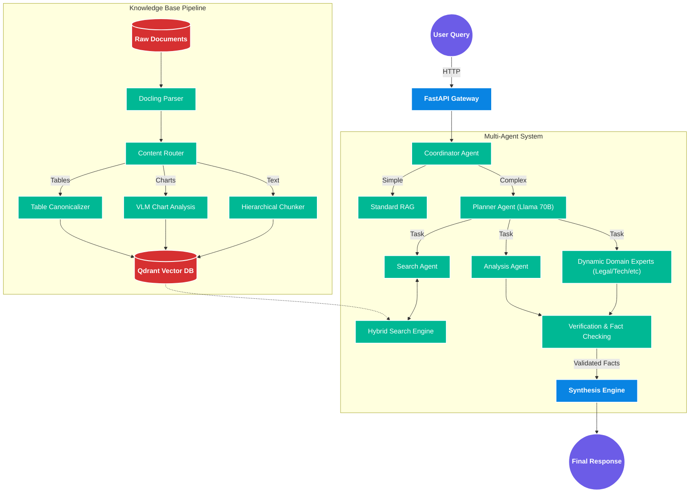

<div align="center">


# 🚀 DexterRA

**An Enterprise-Grade, Multi-Agent Retrieval Augmented Generation System**
<br>
Powered by **NVIDIA NIM APIs**, **FastAPI**, and **Qdrant**

[](https://python.org)
[](https://docker.com)
[](https://fastapi.tiangolo.com/)
[](https://reactjs.org/)
[](https://www.postgresql.org/)
[](https://opensource.org/licenses/MIT)

</div>

---

## 📖 Overview

**DexterRA** is a sophisticated, production-ready AI platform designed to answer complex domain-specific analytical queries from massive, dense documents (400+ pages). It goes beyond traditional RAG models by functioning as a **Planner-Driven Multi-Hop Retrieval** system. 

With its highly extensible **Multi-Agent Orchestration Framework**, DexterRA doesn't just statically search for text. It thinks, breaks down questions, loads the appropriate expert persona (whether a Financial Analyst, Legal Reviewer, or a software engineer), and dynamically coordinates steps across multiple agents to verify, synthesize, and cite an enterprise-grade response.

---

## 🛠️ How It Works

DexterRA behaves like a highly coordinated corporate task-force. When a complex query is submitted, the system goes through these steps:

1. **Intent Analysis & Planning**: The `Coordinator Agent` classifies the query. For complex questions, a 70B parameter Llama-3.1 model writes an execution "plan"—decomposing the big question into several smaller, actionable tasks.
2. **Specialized Agent Routing**: The Coordinator tasks specialized agents. For example:
   * 🔍 **Search Agent**: Navigates the vector database using hybrid search (Dense + Sparse).
   * 📊 **Analysis Agent**: Extracts numbers and statistical trends from the retrieved context.
   * 👔 **Dynamic Domain Experts**: Based on the query, it spins up any of **50+ custom personas** (like an HR Representative or SEO Marketer).
3. **Verification**: A dedicated `Verification Agent` fact-checks the claims, ensures source attribution, and drops insights that fail the hallucination check. 
4. **Synthesis**: The `Synthesis Engine` takes all validated data from the previous steps, generates the final comprehensive answer, explicitly cites its sources from the ingested documents, and streams the answer back to the user via Server-Sent Events (SSE).

---

## ✨ Core Features & Capabilities

- 🤖 **Agentic Reasoning Orchestration**: Dynamic Multi-hop query execution loops (Thought-Action-Observation) driven by LLM Planner sub-agents. 
- 🎭 **Infinite Personality Emulation**: Through the `DynamicExpertAgent` framework, the system will dynamically parse 50+ detailed `.md` prompt templates to forcefully adopt industry personas and adapt its analysis.
- 📄 **Multimodal Document Processing**: Extracts and understands text from native PDFs and DOCX files. Using `Docling` and `LLaVA`, it goes a step further by canonicalizing complex tables and producing VLM summaries of embedded charts/images.
- 🔍 **Hybrid Vector Search Architecture**: High-speed nearest-neighbor retrieval powered by Qdrant. It fuses Deep Learning Embeddings (`NV-EmbedQA`) with sparse keyword matching (`Splade`/BM25) using **Reciprocal Rank Fusion**.
- 💬 **NVIDIA Mistral Reranking**: The top 20 fuzzy results are re-evaluated and accurately reranked by a proprietary NVIDIA reranking model to pull the absolute top 5 contextual chunks.
- � **Streaming Telemetry**: Real-time Server-Sent Events (SSE) chat API combined with full backend observability (designed to hook into Langfuse and Prometheus).
- 🔐 **Enterprise Security**: Production-proven patterns including stateless JWT Authentication via Redis, configurable API Rate Limiting, RBAC infrastructure ready, and NeMo Guardrails preventing prompt-injection logic.
- 🐳 **Seamless Deployment**: Fully Dockerized environments capable of scaling.

---

## 🏗️ System Architecture Flow



---

## 🚀 Quick Start (Dockerized)

### Prerequisites
- Docker & Docker Compose
- **NVIDIA API Key** (Create an account at [build.nvidia.com](https://build.nvidia.com))
- Node.js (for local frontend development)

### 1. Clone & Configure

```bash
git clone https://github.com/mrigankad/context-rag.git
cd context-rag

# Copy environment template
cp .env.example .env

# Edit .env and append your credentials
# NVIDIA_API_KEY=nvapi-xxxxxxxxxxxxxxxxxxxxxxxxxx
```

### 2. Start the Stack

The fastest way to run the entire backend, vector database (Qdrant), and PostgreSQL database is via Docker execution.

```bash
# Using Makefile
make init

# Or using docker-compose manually
docker-compose up -d
```

### 3. Verify Health

```bash
# Check service health
curl http://localhost:8000/health

# Access the beautiful Swagger Interactive Docs
# http://localhost:8000/docs
```

To run the frontend dashboard locally:
```bash
cd frontend
npm install
npm run dev
```

---

## 💻 Tech Stack

- **Backend Architecture**: Python 3.11+, FastAPI (Async), Uvicorn Server
- **AI/LLM Engine**: NVIDIA NIM APIs (Llama 3.1 70B for Planning, NV-EmbedQA for Embeddings, Mistral for Reranking)
- **Deep Database Storage**: PostgreSQL (Metadata/Auth), Qdrant (Vector Store), Redis (Caching/Rate Limiting)
- **Interactive UI**: React 18, TypeScript, TailwindCSS 4, Zustand
- **Document Exporters**: Docling, LLaVA, python-docx

---

## 📁 Complete Repository Structure

```tree
DexterRA/
├── backend/               # Main Python Backend Application
│   ├── api/               # FastAPI Route Handlers (Auth, Chat, Ingestion)
│   ├── core/              # Config, Telemetry, and Security Middlewares
│   ├── db/                # PostgreSQL Models & Connection pooling
│   ├── ingestion/         # Document Parsers, Semantic Chunkers, Visual Extractors
│   ├── services/          # Retrieval, Embedding, Reranking Logic
│   ├── workflow/          # RAG Pipeline Orchestrator
│   └── src/agents/        # Multi-Agent Framework Core
│       ├── base/          # Base Agent Classes & Memory logic
│       ├── domain/        # Hardcoded Experts & DynamicExpertAgent loader
│       ├── prompts/       # 50+ Markdown YAML persona definitions
│       └── coordinator/   # Master agent routing and execution code
├── frontend/              # Fast, responsive React TypeScript UI Dashboard
├── docker/                # Isolated Dockerfiles for Build Targets
├── docs/                  # In-depth Architecture, Features, & Development Plans
├── scripts/               # CI/CD and DB migration utilities 
├── docker-compose.yml     # Local environment orchestration map
└── Makefile               # Task runner instructions
```

---

## ⚙️ Core Configuration Options

Key environment variables in your `.env` file:

| Variable | Default Value | Description |
|----------|---------------|-------------|
| `NVIDIA_API_KEY` | *(Required)* | Grants access to NIM inference scaling. |
| `NVIDIA_LLM_MODEL` | `meta/llama-3.1-70b-instruct` | Primary LLM for Synthesis & Agent Planning. |
| `NVIDIA_EMBED_MODEL`| `nvidia/nv-embedqa-e5-v5` | Dense Embedding Model (1024 dims). |
| `CHUNK_SIZE` | `512` | Token length per semantic chunk. |
| `TOP_K_RETRIEVAL` | `12` | The number of initial chunks to retrieve before reranking. |

---

## 📈 Roadmap & Progress Matrix

This project operates on a 4-phase structured rollout:

| Phase | Category | Goal / Feature | Status | Priority |
|:---:|---|---|:---:|:---:|
| **Phase 1** | **Performance** | DB Connection Pool & Vector Query Optimization (<3s Latency) | 🔄 In Progress | 🔴 High |
| **Phase 1** | **Code Quality** | Comprehensive PyTest Integration & Latency Benchmark Tests | 🔄 In Progress | 🔴 High |
| **Phase 2** | **Reasoning** | Agentic CoT (Thought-Action loops, Coordinator Agent) | ✅ Complete | 🔴 High |
| **Phase 2** | **Personas** | Dynamic Multi-Agent System loader with 50+ Markdown Personas | ✅ Complete | 🔴 High |
| **Phase 2** | **Ingestion** | Advanced Table Preservation & LLaVA Document Graph Mapping | ⏳ Planned | 🟡 Medium |
| **Phase 2** | **Verification** | Entailment checking & Hallucination detection Agents | ⏳ Planned | 🔴 High |
| **Phase 3** | **Scaling** | K8s Horizontal Pod Autoscaling (HPA) & Qdrant Cluster Sharding | ⏳ Planned | 🔴 High |
| **Phase 4** | **Enterprise** | Multi-Tenancy (Row-level Security, DB logical separation) | ⏳ Planned | 🔴 High |

---

## 🤝 Contributing
Contributions are welcome! Please ensure you check the `docs/` directory for Architectural guidelines, particularly `CODEBASE_OVERVIEW.md` and `MULTI_AGENT_ARCHITECTURE.md`, before taking on large refactors. 

Run `make test` and `make lint` before opening a PR.

## 📝 License
This project is licensed under the **MIT License**.

<div align="center">
<i>Built with ❤️ using NVIDIA NIMs</i>
</div>
