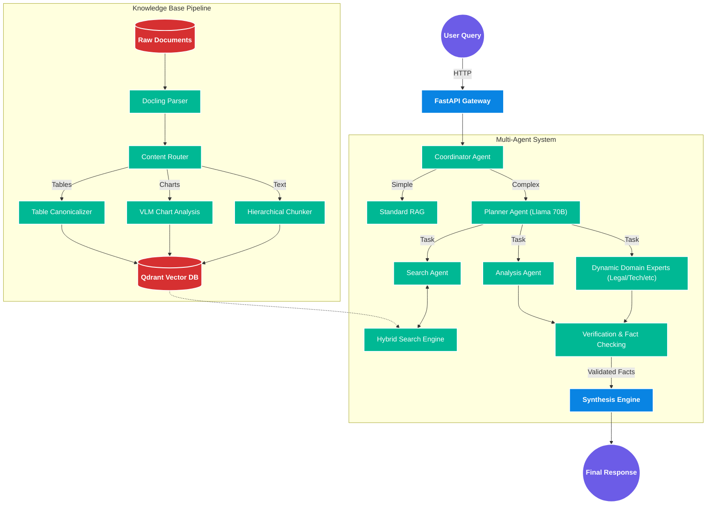

<div align="center">

# 🚀 Context RAG (Dexter Retrieval Agent)


**An Enterprise-Grade, Multi-Agent Retrieval Augmented Generation System**
<br>
Powered by **NVIDIA NIM APIs**, **FastAPI**, and **Qdrant**

[](https://python.org)
[](https://docker.com)
[](https://fastapi.tiangolo.com/)
[](https://reactjs.org/)
[](https://www.postgresql.org/)
[](https://opensource.org/licenses/MIT)

</div>

---

## 📖 Overview

Context RAG is a sophisticated, production-ready AI platform designed to answer complex domain-specific analytical queries from large, dense documents (400+ pages). It has evolved from standard RAG to a **Planner-Driven Multi-Hop Retrieval** system featuring **Advanced Multimodal Ingestion** and a highly extensible **Multi-Agent Orchestration Framework**. 

Whether you need to parse financial tables, analyze legal contracts, or extract medical insights, Context RAG dynamically loads expert personas and coordinates their reasoning to synthesize an accurate, highly-cited answer.

### ✨ Core Capabilities

- � **Dynamic Multi-Agent Orchestration**: Queries aren't just embedded and searched. They are routed to a Coordinator Agent that plans execution steps across specialized sub-agents (Search, Analysis, Verification, and Synthesis).
- 🎭 **50+ Specialized Personas**: Through the `DynamicExpertAgent` framework, the system can dynamically adopt any of 50+ expert personas (e.g., SEO Marketer, Legal Expert, DevOps Engineer) defined in Markdown YAML templates.
- 📄 **Multimodal Document Processing**: Uses Docling and LLaVA to extract and understand PDFs, DOCX, complex Tables, and Charts natively.
- 🔍 **Hybrid Vector Search**: Qdrant-powered dense (NV-EmbedQA) + sparse (Splade/BM25) search with Reciprocal Rank Fusion & NVIDIA Mistral Reranking.
- 💬 **Streaming Telemetry**: Real-time Server-Sent Events (SSE) chat with Langfuse observability.
- 🔐 **Enterprise Security**: JWT Authentication, Rate Limiting, RBAC ready, and NeMo Guardrails for LLM safety.
- 🐳 **Seamless Deployment**: Fully Dockerized with `docker-compose`.

---

## 🏗️ System Architecture

Context RAG utilizes a multi-layered reasoning engine alongside a high-throughput data ingestion pipeline.



---

## 🚀 Quick Start (Dockerized)

### Prerequisites
- Docker & Docker Compose
- **NVIDIA API Key** (Create an account at [build.nvidia.com](https://build.nvidia.com))
- Node.js (for local frontend development)

### 1. Clone & Configure

```bash
git clone https://github.com/mrigankad/context-rag.git
cd context-rag

# Copy environment template
cp .env.example .env

# Edit .env and append your credentials
# NVIDIA_API_KEY=nvapi-xxxxxxxxxxxxxxxxxxxxxxxxxx
```

### 2. Start the Stack

The fastest way to run the entire backend, vector database (Qdrant), and PostgreSQL database is via Docker execution.

```bash
# Using Makefile
make init

# Or using docker-compose manually
docker-compose up -d
```

### 3. Verify Health

```bash
# Check service health
curl http://localhost:8000/health

# Access the beautiful Swagger Interactive Docs
# http://localhost:8000/docs
```

To run the frontend dashboard:
```bash
cd frontend
npm install
npm run dev
```

---

## � Tech Stack

- **Backend**: Python 3.11+, FastAPI (Async), Uvicorn
- **AI/LLM**: NVIDIA NIM APIs (Llama 3.1 70B for Planning, NV-EmbedQA for Embeddings, Mistral for Reranking)
- **Databases**: PostgreSQL (Metadata/Auth), Qdrant (Vector Store), Redis (Caching/Rate Limiting)
- **Frontend**: React 18, TypeScript, TailwindCSS 4, Zustand
- **Document Extractors**: Docling, LLaVA, python-docx

---

## 📁 Repository Structure

```tree
Context RAG/
├── backend/               # Main Python Backend Application
│   ├── api/               # FastAPI Route Handlers (Auth, Chat, Ingestion)
│   ├── core/              # Config, Telemetry, and Security
│   ├── db/                # PostgreSQL Models & Connection pooling
│   ├── ingestion/         # Document Parsers, Semantic Chunkers, Visual Extractors
│   ├── services/          # Retrieval, Embedding, Reranking Logic
│   ├── workflow/          # RAG Pipeline Orchestrator
│   └── src/agents/        # Multi-Agent Framework
│       ├── base/          # Base Agent Classes & Memory
│       ├── domain/        # Hardcoded Experts & DynamicExpertAgent loader
│       ├── prompts/       # 50+ Markdown YAML persona definitions
│       └── coordinator/   # Agent routing and execution logic
├── frontend/              # React TypeScript UI Dashboard
├── docker/                # Isolated Dockerfiles for Build Targets
├── docs/                  # In-depth Architecture, Features, & Plans (Moved here for cleanliness)
├── scripts/               # CI/CD and DB migration utilities 
├── docker-compose.yml     # Local orchestration map
└── Makefile               # Task runner instructions
```

---

## ⚙️ Core Configuration 

Key environment variables in your `.env` file:

| Variable | Default Value | Description |
|----------|---------------|-------------|
| `NVIDIA_API_KEY` | *(Required)* | Grants access to NIM inference scaling. |
| `NVIDIA_LLM_MODEL` | `meta/llama-3.1-70b-instruct` | Primary LLM for Synthesis & Agent Planning. |
| `NVIDIA_EMBED_MODEL`| `nvidia/nv-embedqa-e5-v5` | Dense Embedding Model (1024 dims). |
| `CHUNK_SIZE` | `512` | Token length per semantic chunk. |
| `TOP_K_RETRIEVAL` | `12` | The number of initial chunks to retrieve before reranking. |

---

## � Roadmap & Progress tracker

This project operates on a 4-phase structured rollout:

| Phase | Category | Goal / Feature | Status | Priority |
|:---:|---|---|:---:|:---:|
| **Phase 1** | **Performance** | DB Connection Pool & Vector Query Optimization (<3s Latency) | 🔄 In Progress | 🔴 High |
| **Phase 1** | **Code Quality** | Comprehensive PyTest Integration & Latency Benchmark Tests | 🔄 In Progress | 🔴 High |
| **Phase 2** | **Reasoning** | Agentic CoT (Thought-Action loops, Coordinator Agent) | ✅ Complete | 🔴 High |
| **Phase 2** | **Personas** | Dynamic Multi-Agent System loader with 50+ Markdown Personas | ✅ Complete | 🔴 High |
| **Phase 2** | **Ingestion** | Advanced Table Preservation & LLaVA Document Graph Mapping | ⏳ Planned | 🟡 Medium |
| **Phase 2** | **Verification** | Entailment checking & Hallucination detection Agents | ⏳ Planned | 🔴 High |
| **Phase 3** | **Scaling** | K8s Horizontal Pod Autoscaling (HPA) & Qdrant Cluster Sharding | ⏳ Planned | 🔴 High |
| **Phase 4** | **Enterprise** | Multi-Tenancy (Row-level Security, DB logical separation) | ⏳ Planned | 🔴 High |

---

## 🔐 Security & Operations
- **Traffic Safety**: NeMo Guardrails integrated to catch and sanitize bad LLM logic.
- **Authentication**: JWT based Access Control handled via Redis state tracking.
- **Observability**: Designed to easily hook into Prometheus, Grafana, and Langfuse for production system traces.

## 🤝 Contributing
Contributions are welcome! Please ensure you check the `docs/` directory for Architectural guidelines, particularly `CODEBASE_OVERVIEW.md` and `MULTI_AGENT_ARCHITECTURE.md`, before taking on large refactors. 

Run `make test` and `make lint` before opening a PR.

## 📝 License
This project is licensed under the **MIT License**.

<div align="center">
<i>Built with ❤️ using NVIDIA NIMs</i>
</div>
